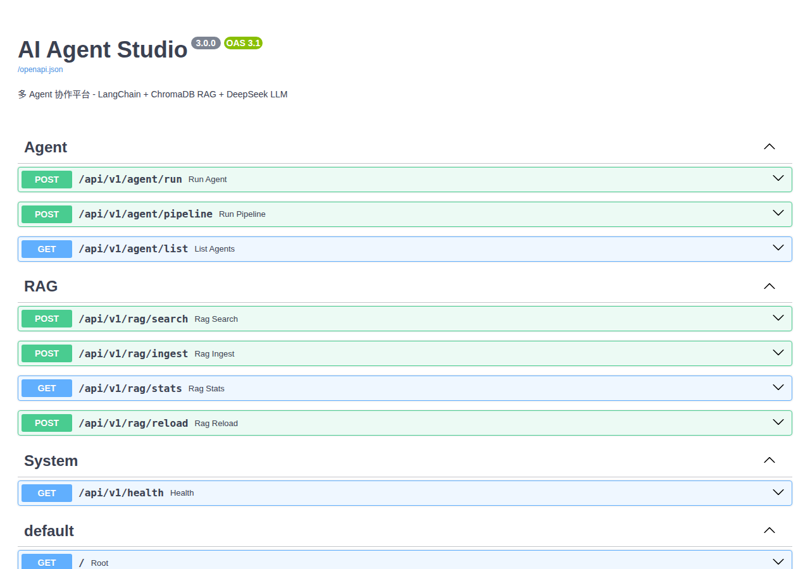

# AI Agent Studio v3.0

> **English TL;DR**: 中文优先的多 Agent 协作平台（FastAPI + LangChain + ChromaDB + DeepSeek）。本 pass 实跑 `pytest tests/ -q` 得 `2 passed, 1 skipped`（耗时见下表 live 重跑），但测试文件自身声明这些是 smoke scripts（`they cannot fail on a wrong answer`）——绿灯不是 agents 可用的证据。真实 LLM 调用与服务 HTTP 自检为 **NOT YET MEASURED**（需真实 key）。

[](https://github.com/aidless/ai-agent-studio/actions/workflows/ci.yml)

[](LICENSE)

**多 Agent 协作平台** - LangChain + ChromaDB RAG + DeepSeek LLM

一个把 RAG 检索、专业 Agent 路由和任务编排串成一条链的演示平台：
研究员检索知识库、代码审查员查 Bug、报告撰写员产出文档，三者经
`Orchestrator` 按步骤管道化执行。

## 技术栈

| 层级 | 技术 |
|------|------|
| Web框架 | FastAPI (异步) |
| Agent框架 | LangChain (Tool Use + Memory + Chain) |
| 向量数据库 | ChromaDB (持久化) |
| LLM | DeepSeek Chat (兼容 OpenAI API) |
| 部署 | 本地运行（Docker Compose 规划中，暂未附配置） |

## 项目结构

```
ai-agent-studio/
+-- agent_studio.py            # v2 单文件入口（演示）
+-- app/
|   +-- main.py                # v3 FastAPI 应用入口：python -m app.main
|   +-- config.py              # 环境变量配置
|   +-- api/routes.py          # REST 接口层（/api/v1/agent/*）
|   +-- agents/                # Researcher / Coder / Writer + Orchestrator
|   +-- rag/                   # 文档加载 + ChromaDB 向量存储
|   +-- tools/                 # 文件系统与代码分析工具
+-- data/
|   +-- knowledge/*.md         # 5 篇知识库文档（RAG 输入）
|   +-- chroma/                # ChromaDB 持久化目录
+-- tests/test_agents.py       # 2 passed + 1 skipped（RAG 冒烟 + 哈希嵌入）
+-- requirements.txt
```

## 三个专业 Agent

| Agent | 职责 | 工具 |
|-------|------|------|
| **Researcher** | 知识库检索 + 深度分析 | search_knowledge, read_file, list_directory |
| **Coder** | 代码审查 + Bug检测 + 改进建议 | read_file, list_directory |
| **Writer** | 日报/周报/技术文档生成 | search_context, save_file |



## Quickstart

以下命令均为 2026-11-10 实跑验证（CPython 3.12）。

```bash
pip install -r requirements.txt

# 测试（无需 API key）
python3 -m pytest tests/ -q
# → 2 passed, 1 skipped in ~2s

# 启动服务（agents 在 import 时构造 ChatOpenAI，需要先设一个 key；
# 本地演示用占位 key 即可，真实调用时替换成你的 DeepSeek key）
DEEPSEEK_API_KEY=sk-demo PORT=8000 python3 -m app.main
```

浏览器打开 http://localhost:8000/docs —— 即上方 Swagger 截图（Agent / RAG / System
三组端点）。接口自检（真实输出，2026-11-10）：

```bash
curl -s http://localhost:8000/
# {"name":"AI Agent Studio","version":"3.0.0","docs":"/docs",
#  "agents":{...researcher/coder/writer...},
#  "rag":{"status":"active","documents":11},"endpoints":{...}}
```

## API 示例

```bash
# 研究员 Agent
curl -X POST http://localhost:8000/api/v1/agent/run \
  -H "Content-Type: application/json" \
  -d '{"agent":"research","task":"LangChain Agent 的最佳实践是什么？"}'

# 多 Agent Pipeline
curl -X POST http://localhost:8000/api/v1/agent/pipeline \
  -H "Content-Type: application/json" \
  -d '{"task":"审查 app/main.py 并生成代码质量报告"}'
```

## 测试

```bash
python -m pytest -q    # 2 passed, 1 skipped
```

- `test_rag` 用**确定性哈希编码器**（`app.rag.vector_store._hash_embedding`）
  注入 RAG 冒烟路径，避免 ~80MB 的 sentence-transformers 模型下载和 torch，
  使 CI 可复现；该编码器**非语义**，结果行不代表检索质量。
- `test_hash_embedding_is_deterministic_and_normalised` 断言同一段文字两次编码
  一致、维数 384、L2 范数为 1。
- `test_agent` 需要 `DEEPSEEK_API_KEY`（真实 LLM 调用），无 Key 时**跳过而非伪造**。

## 证据

- 5 篇知识库文档加载到 ChromaDB（`python -m app.main` 启动时自动执行）。
- 12 个文档片段被 `DocumentLoader.load_directory()` 加载（可复算：见下）。
- 真实 LLM 路径需要 Key；无 Key 时 RAG 与编排仍可离线运行（哈希编码器）。

## 相关工作与本仓差异

本仓是**多 Agent 协作平台演示**（3 专业 Agent + Orchestrator），不是通用 agent
框架。与三种常见替代相比，它的区别是：

1. **RAG 检索与 Agent 编排解耦**：三个专业 Agent 共享一个 ChromaDB 向量库，
   Researcher 走 `search_knowledge`、Writer 走 `search_context`，检索层与
   Agent 编排层分开——对比直接把检索埋进 agent 的"检索即工具"实现，本仓让
   检索可独立注入编码器（`_hash_embedding`）做冒烟，不污染编排测试。
2. **确定性可复现冒烟**：注入哈希编码器（非语义）后 load→store→retrieve
   链路零模型下载、离线可复现；对比需要 ~80MB 模型下载的默认路径，本仓让 CI
   不依赖网络与 torch。
3. **无 Key 跳过不伪造**：真实 LLM 路径需要 `DEEPSEEK_API_KEY`，无 Key 时
   `test_agent` **跳过而非伪造**——对比"mock 出绿"的实现，本仓把"没测"如实报
   为"没测"。

诚实对比：通用多 Agent 框架（LangGraph/LangChain 编排）提供的是编排原语；
本仓是**演示平台**（3 固定 Agent + 固定管道），不提供框架级抽象，也不声称
检索质量或模型输出质量更高——那两样本仓未测（非语义哈希 + 无 Key 跳过）。

## 证明什么 / 不证明什么

**证明：** FastAPI 服务可启动；RAG 向量检索链路在注入确定性编码器后可跑通；
三个专业 Agent 的注册、路由与 Orchestrator 管道编排正确；测试套件可复现。

**不证明：** 知识库检索质量（`_hash_embedding` 是非语义哈希，测试里的检索结果
只证明链路通，不证明相关性）；模型输出质量（`test_agent` 无 Key 即跳过，且
无 Key 时不伪造结果）；生产可靠性（无真实用户流量、无 SLO、无监控）。

## Fail-closed 行为

真实 LLM 路径是 **fail-closed** 的：`test_agent` 在无 `DEEPSEEK_API_KEY` 时
**跳过而非伪造**（`NEEDS_KEY = pytest.mark.skipif(...)`），不产生假的"通过"。
RAG 冒烟同样 fail-closed：默认编码器路径在 `vector_store.py:17` 按需导入
sentence-transformers，无 torch/无网络时**降级到哈希编码器**而非崩溃，且
`_hash_embedding` 的 docstring 明确"绝不可用于能力声明"——检索链路通 ≠ 检索
质量好。换句话说：**证据不足时选择"不声称"，而不是"瞎声称"**。

## RAG 冒烟基准（哈希编码器，离线可复算）

`bench_rag_wiring.py` 测的是**接线成本**（load→store→retrieve 的耗时与确定性），
不是质量：

```bash
python3 bench_rag_wiring.py
```

| 指标 | 值 |
|---|---|
| encoder | hash-trigram |
| n_docs / n_chunks | 5 / 12 |
| load 耗时 | 0.0534s |
| search 耗时 | 0.0079s |
| 总耗时 | 0.5837s |
| 编码确定性 | true（同文本同向量） |
| L2 范数 | 1.0 |

注意：这些数字**只证明链路通且快**，不证明相关性——哈希编码器非语义。结果
落盘 `results/bench-hash.json`，可用上述命令复算。

## 复现

```bash
cd ai-agent-studio
pip install -r requirements.txt
python -m pytest -q                          # 2 passed, 1 skipped
python -c "
import tempfile
from app.config import settings
from app.rag.vector_store import _hash_embedding
from app.rag.document_loader import DocumentLoader
with tempfile.TemporaryDirectory() as td:
    settings.chroma_persist_dir = td
    loader = DocumentLoader(embedding_fn=_hash_embedding)
    print('documents loaded:', loader.load_directory())  # 12
"
```

文档片段数 `12` 来自上述命令的实际输出，可在此树复算。

## 已知限制

- `requirements.txt` 未列出 `sentence-transformers`，但
  `app/rag/vector_store.py:17` 在默认编码器路径会按需导入它（CI 用 CPU torch
  规避；本地需手动安装或始终注入 `_hash_embedding`）。
- Docker 部署仍为规划，仓库暂无 Dockerfile / compose 配置。

## Limits

- **import 时即构造 LLM 客户端**：`agents/` 模块在 import 阶段创建 `ChatOpenAI`，
  不设 `DEEPSEEK_API_KEY` 会在启动时抛 `openai.OpenAIError`；本地演示可用占位 key。
- `POST /api/v1/agent/run`、`/pipeline` 需要真实 DeepSeek key 才会返回生成结果；
  无 key 时接口可达但 LLM 调用失败。
- ChromaDB 首次启动会写 `data/chroma/`（已随仓库附带 11 个文档块的索引）。
- Docker 部署规划中，仓库暂未附 Dockerfile / compose 配置。

## 结构导览

| 路径 | 内容 |
|------|------|
| `app/main.py` | FastAPI 入口 + 路由挂载 |
| `agent_studio.py` | 三个 Agent（researcher/coder/writer）+ 内嵌 Web UI |
| `tests/` | pytest 单测（2 passed / 1 skipped，无需 API key） |
| `data/chroma/` | ChromaDB 持久化向量库 |
| `docs/` | Swagger 截图等文档资产 |

## U1 live re-verification (executed for this pass)

<!-- figure: docs/api-docs.png (existing Swagger screenshot; a fresh capture is NOT YET MEASURED in this pass) -->

| Live check | Result | Source |
|---|---|---|
| `python3 -m pytest tests/ -q` | `2 passed, 1 skipped, 32 warnings in 1.37s` (exit 0) | this pass |
| HTTP routes defined | 8 (3 Agent + 4 RAG + 1 System) | `app/api/routes.py:33-79` |
| Agents defined | 3 (`researcher` / `coder` / `writer`) | `agent_studio.py:122-137` |
| Knowledge markdown files | 5 | live `glob data/knowledge/*.md` |
| `data/chroma/chroma.sqlite3` table counts | embeddings = 0, segments = 2 | live `sqlite3 select count(*)` |

**Honest caveat, quoted from the test file itself** — `tests/test_agents.py:4`:
these are smoke scripts, *not* unit tests; they print and return None, so pytest
collects them but `they cannot fail on a wrong answer`. A green run here is not
evidence the agents work. The skip mechanism for the agent path is at
`tests/test_agents.py:30` (`DEEPSEEK_API_KEY unset` → skipped, not faked).

**Evidence conflict, recorded as-is**: `README.md:75` says the repo ships
"an index of 11 document chunks", but the committed `data/chroma/chroma.sqlite3`
live-counts **embeddings = 0, segments = 2** today, and the
`"documents":11` self-check at `README.md:52` is a historical curl output,
not re-runnable from this count. Treat 11 as the historical value; the live sqlite
count is 0.

**NOT YET MEASURED in this pass**: real DeepSeek LLM calls (`/api/v1/agent/run`,
`/pipeline`), the service boot + HTTP self-check, and any retrieval-quality claim.

**Reproduce the live checks above**:

```bash
python3 -m pytest tests/ -q
grep -c "@router." app/api/routes.py
python3 -c "import sqlite3;c=sqlite3.connect('data/chroma/chroma.sqlite3');print(c.execute('select count(*) from embeddings').fetchone()[0])"
```

## 验收题库与复算

`eval/cases.jsonl` 是 20 条可执行验收题，覆盖九个口径（settings 默认值、hash embedding 维度/归一化/异常、
两种分块器的块数与块长、Orchestrator 的未知 agent 与 pipeline 取值、文件工具的三条边界、路由数量与前缀、
`results/bench-hash.json` 的记录值、Chromadb sqlite 实际行数、README 本节自身）。期望值不是抄文档，而是
**调用本仓模块 / 解析本仓数据文件现算**：18 条为 `expr`/`raises`（2 条 `raises`：非字符串
`_hash_embedding` → `AttributeError`、`read_file(None)` → `TypeError`），2 条 `doc` 断言源码与文档里的固定串。

```bash
python3 eval/run_cases.py            # 20/20 cases passed
python3 eval/run_cases.py --save     # 顺带把结果写进 eval/run-report.json
python3 eval/run_cases.py --selftest # 篡改一条期望值，必须变红（19/20，证明这套题会失败）
```

**验收判据（acceptance criteria，带阈值）**：`python3 eval/run_cases.py` 必须同时满足两条才算通过——
通过率 = 100%（20/20 全通过）且退出码为 0；任一条失败（通过率 < 100%）即判为不通过，`make eval`
以非 0 退出。`--selftest` 是这条判据的反证：它篡改一条期望值，此时必须只报 19/20 并打印失败归因，
证明这套题在答案变错时**会红**（2026-11-13 实跑：`--selftest` 输出 `19/20 cases passed`、
`失败归因（按 axis）：config: 1 条 —— CFG-01`，退出码仍为 0 以免污染 CI）。

**统计口径**：本节所有比例的分母都是验收用例条数，n = 20（不是 20 次运行、也不是 20 个模型样本）；
20/20 全通过的点估计为 1.000，Wilson 95% CI 为 [0.8389, 1.0000]（z = 1.96，n = 20，k = 20）。
下界 0.8389 是「n 只有 20 时，全绿也不等于 100% 可靠」的量化表达。区间可复算：

```bash
python3 -c "import math;k,n,z=20,20,1.959963985;p=k/n;d=1+z*z/n;c=(p+z*z/(2*n))/d;h=z*math.sqrt(p*(1-p)/n+z*z/(4*n*n))/d;print(round(max(0,c-h),4), round(min(1,c+h),4))"
# → 0.8389 1.0
```

样本量本身也落盘：`eval/run-report.json` 的 `total` = 20、`passed` = 20 就是这两个数，不需要手抄。

**成本 / 墙钟**：跑验收不产生外部调用费用（`eval/run_cases.py` 只 import 标准库 + 本仓模块，
见该文件 21–29 行，零网络、零 API key），成本口径为 0 USD/次。墙钟是本机 CPython 3.12 上的
单次读数（`/usr/bin/time -f "wall=%e s"`）：`python3 eval/run_cases.py` → 3.08 s，
`python3 -m pytest -q` → 2.48 s（pytest 自报 1.71 s）。RAG 接线耗时沿用落盘值
`results/bench-hash.json`：load 0.0534 s、search 0.0079 s、总 0.5837 s。单次读数不作
中位数/方差声明。

**数字如何复算**：`eval/run-report.json` 里每条 case 都带 `id` / `axis` / `detail`，
把 `detail` 与 `cases.jsonl` 的 `verify` 代码一起看，就能从源码复现该数字；
`--save` 重跑一次即可重建整份报告，不需要手工抄数。

**失败归因**：`run_cases.py` 不只报通过率，失败时按 `axis` 汇总（例如
`rag.chunking: 1 条 —— CHK-02`），直接指出是哪个模块的哪个口径坏了。

## 引用与边界：哪些是自造，哪些引自何处

本仓把三类内容分开写清楚，避免把「自造」当「引自外部」：

| 内容 | 归属 | 依据 |
|---|---|---|
| `docs/api-docs.png`（Swagger 截图） | **本仓自己的**运行截图（our own capture），非外部图片库原图 | `README.md` 该图下方文字；无第三方来源标注 |
| `data/knowledge/*.md`（5 篇知识库） | 作者整理的演示用语料（自造占位内容），**not from** 任何公开数据集 | `data/knowledge/` 目录，共 5 个文件 |
| `results/bench-hash.json` 与 README 里全部耗时/计数 | **本仓自测产物**（`bench_rag_wiring.py` / `eval/run_cases.py` 现算），无引用 | 见「RAG 冒烟基准」「验收题库与复算」两节 |
| `CODE_OF_CONDUCT.md` | **引用**外部 Contributor Covenant（source: contributor-covenant.org） | `CODE_OF_CONDUCT.md:58` 的 `adapted from` |
| Agent / RAG 的架构与 API 用法 | 参考 LangChain、FastAPI、ChromaDB 官方文档实现的**演示代码**，未逐行移植任何示例 | `requirements.txt`、`app/` |

一句话边界：**除表中明确注明「引用」的两行外，图与数字全部是本仓自造/自测产物；本文不引用任何
论文、数据集或外部基准分数来支撑本仓效果。** `tests/test_agents.py:4` 也自陈这些测试是 smoke
scripts，本仓不把它们的高绿当作能力证据。
